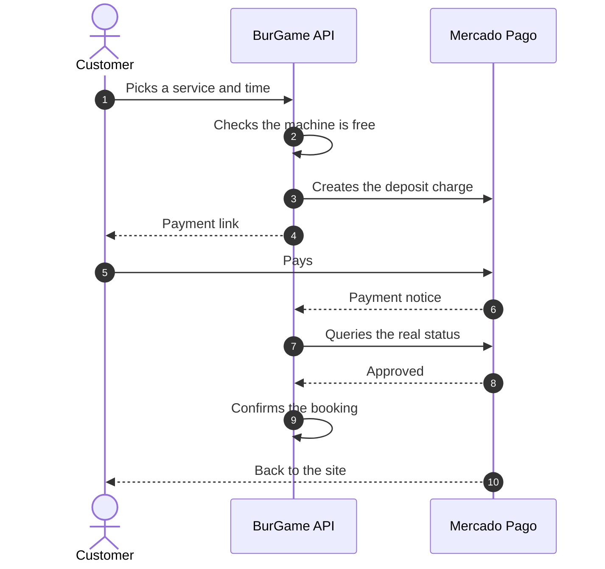
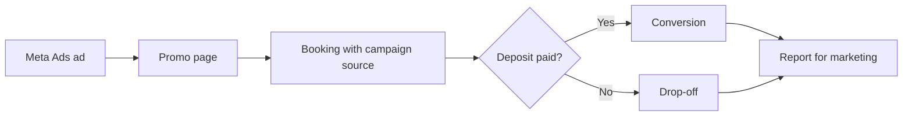

### How booking and payment work

The booking waits until Mercado Pago confirms the charge. The backend doesn't trust the notice: it asks for the status again before confirming.

### From ad to paid booking

Every booking stores which campaign it came from, so the business can measure which ads end in a payment.

