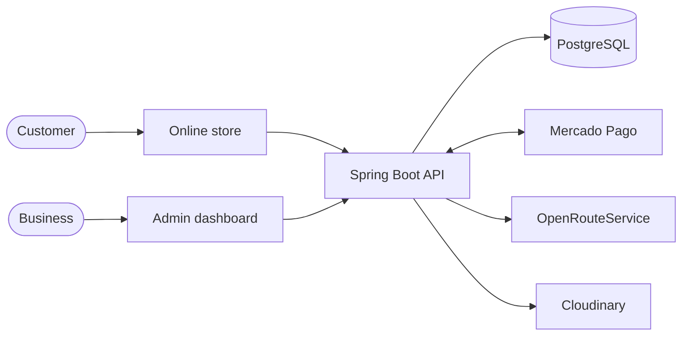
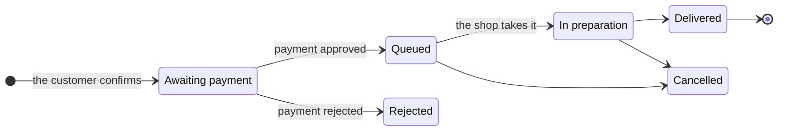

### How the pieces connect

The store and the dashboard talk to the same API. The API is the only one that knows the prices, talks to Mercado Pago and calculates shipping.

### The life of an order

An order starts out waiting for payment, and only reaches the kitchen once Mercado Pago confirms it was charged.

